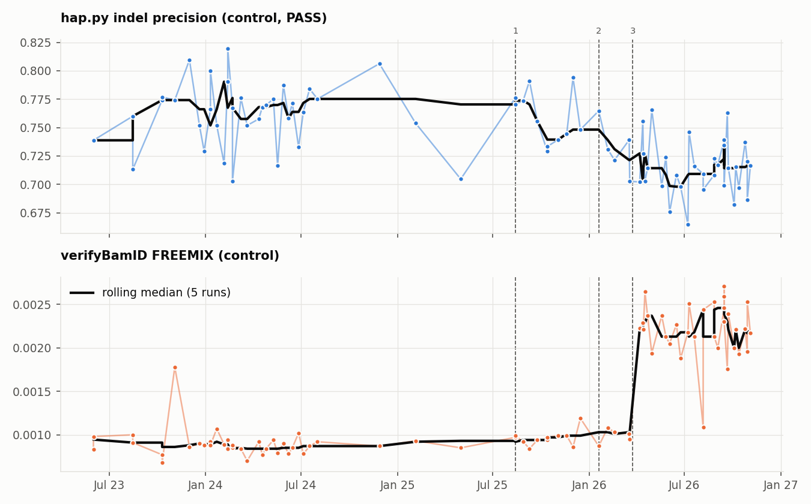
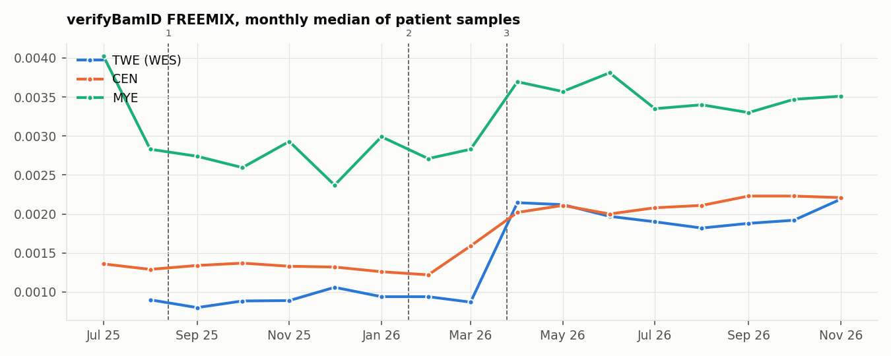
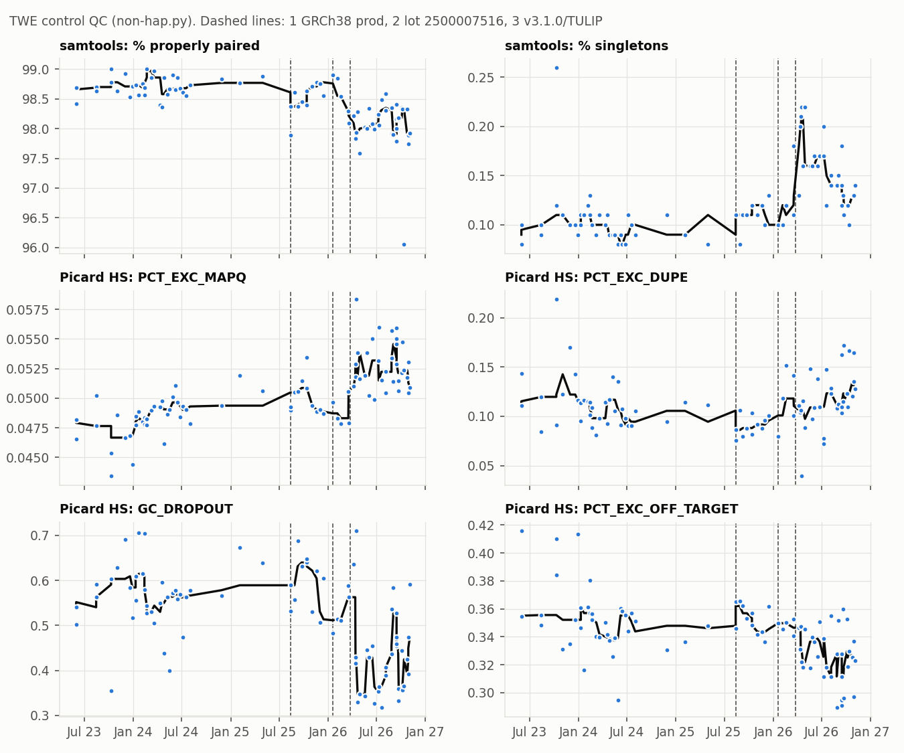
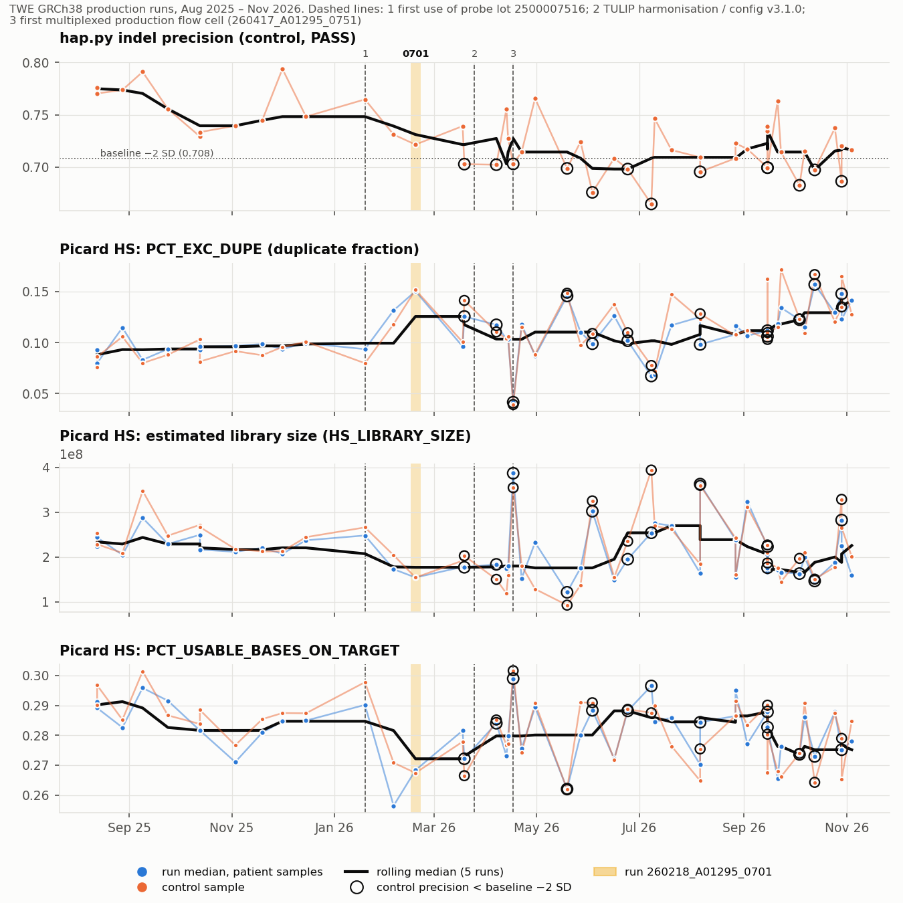
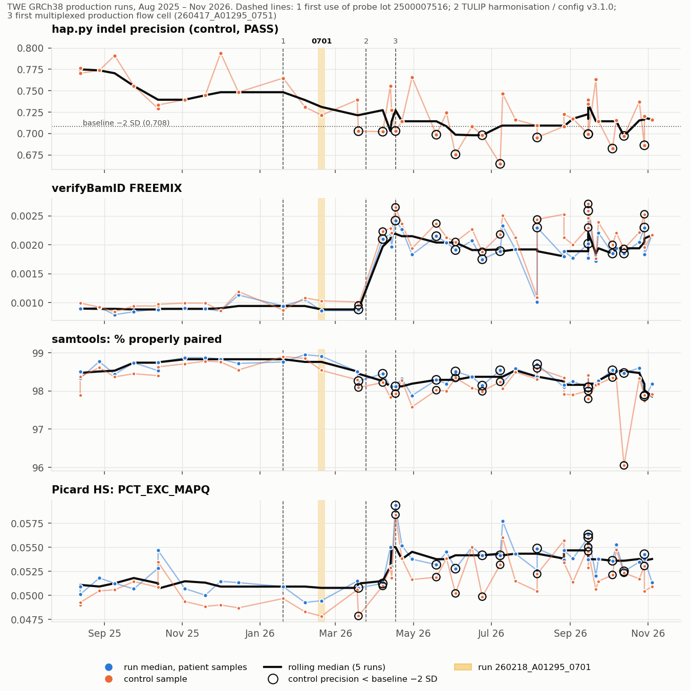
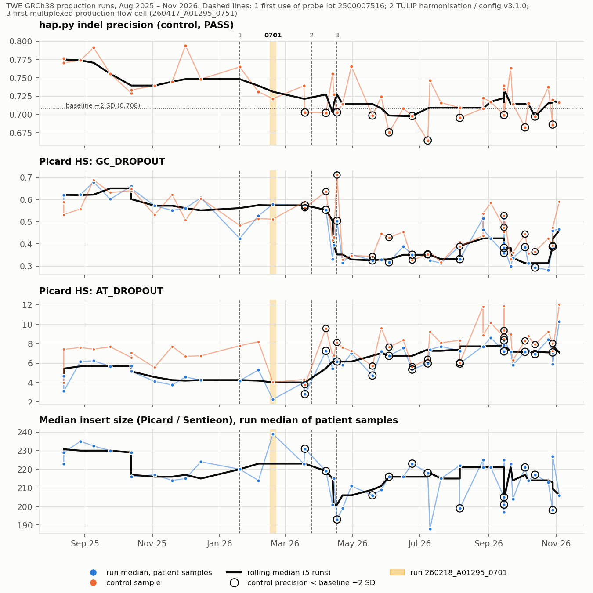

# TWE (WES) indel precision investigation: summary

*Prepared 19 Nov 2026; updated 20 Nov 2026. Sources:*
- *Main source: `O-260716 TWE investigation run` (Confluence export).*
- *Background:*
  - *`O-260703 WES Indels` and `O-TWE Indel impact`*
  - *`DV-Multiplexing S1 flow cell QC assessment` (approved 12 Mar 2026)*
  - *`INDEL_inv_initial_dev_des.pptx`, `INDEL_Dev_des_2.pptx`, `INDEL_inv_rerun_analysis.pptx`, `INDEL summary.docx`*
- *QC data: the verity database snapshot `verity_db_20261117_1311.tar.gz` (file-JFy551Q4JKFVPKkJ7bqJ497k, project 003_eggd_verity_dev), queried read-only.*

### Key findings at a glance
- **The drop happened in two stages, and each has its own QC signature.**
  1. **Feb–Mar 2026: library complexity was lost before harmonisation and multiplexing.**
     - Run 260218_A01295_0701 is the first production run with the drop. On that run, the control and the patient samples alike show a sharp rise in duplicates and a fall in estimated library size. Runs 0690 and 0727 show the same pattern.
     - Before TULIP, duplication correlates with precision (ρ = −0.57 to −0.62).
  2. **Late Mar / Apr 2026 onwards: a step change with TULIP harmonisation.**
     - FREEMIX rises about 2.4× in TWE, CEN and MYE. Properly paired % falls, low-MAPQ exclusion rises, GC dropout falls and insert size shortens.
     - Most runs after this step are below the baseline −2 SD for precision.
- **Flow-cell multiplexing (mixed assays) adds no visible change.** The step comes before the first multiplexed TWE flow cell (260417_A01295_0751). The multiplexing validation also attributes the FREEMIX rise to harmonisation.
- **Sequencing quality did not change** (Q30, error and mismatch rates), **and neither did depth.**
- **The error type matches the QC picture.** The GT errors and extra FPs sit at repeat loci. Lower library complexity and harmonisation-related changes to capture and PCR both plausibly widen the spread of allele fractions there (Section 3).

---

## Section 1: Investigation summary

### Problem
- hap.py indel precision for the TWE control (NA12878 / 9526) has been falling, and indel recall has become less consistent. TWE runs were put on hold because of the risk that a pathogenic indel would be missed or that a false indel would be reported.
- The trend was found with Westgard-style rolling and individual plots, using the first 30 runs as the baseline. Realigning older GRCh37 runs to GRCh38 lowers their precision slightly, but the downward trend is still there.
- Precision has gone from about 0.75–0.80 (2024–2025) to about 0.70–0.72 (Apr–Nov 2026).
- **The first production run to show the drop is 260218_A01295_0701** (26-NGWES3, precision 0.721, recall 0.905). It came before multiplexing in production. Multiplexing was in use only for the multiplexing validation runs at that point.

### What was ruled out (background investigation)
| Candidate | Finding |
|---|---|
| Conductor config v2.5.0 / dias_single v2.14 | No change to calling. The testing-page precision of 0.806 came from a run that already had ~0.80. |
| Sentieon v5.1.0 | v5.1.0 vs v4.2.2 gave 100% concordance. Re-running hap.py on the v5.1.0 control gave the production value. |
| hap.py assets (truth VCF/BED, SDF, panel BED) | None changed since 2023–25. |
| UMI masking | Re-running 260319_A01295_0727 with the UMI-masking config made no difference to indel precision. |
| Post-capture PCR cycles | 8 cycles (251027_…0652) vs 11 cycles (251103_…0625) showed no obvious difference. |
| Control stock / extraction | Same control used throughout. The Chemagic go-live and pause did not line up with the drop. |

**Left open:**
- **Twist reagent lots.** The drops map to lot changes, especially probe lot 2500007516 (from 26-NGWES1, Jan 2026). One hybridisation reagent lot may have been held at the wrong temperature. Twist were contacted on 18/06/2026.
- **The TULIP unified library prep (CU-NG-SOP-32, live 17 Mar 2026).** It drops the WES 95 °C pre-denaturation before the 70 °C hybridisation hold. It also lists 11 enrichment PCR cycles, although CU-VVP-92 says WES stays at 8.
- **Why CEN shows no drop.** CEN shares the same harmonised wet lab and the same control, but its truth set has only about 6 indels, so it is not sensitive to this.

**Multiplexing validation (S1 flow cells, approved 12 Mar 2026):**
- TWE, CEN and MYE samples pass QC when multiplexed.
- Contamination (FREEMIX) roughly doubles against production (TWE 0.08% → 0.25%). Most of that rise is already present in harmonisation runs (0.20%), so it is attributed to harmonisation rather than multiplexing.
- TWE insert size fell by 25 bp. TWE mapped reads were 16.5% lower, but still above thresholds.

### Validation re-run (38_TWE-260715_0833)
- The original 2025 TWE samples were re-sequenced and compared sample-to-sample against their original VCFs with vcfeval/hap.py. Three regions were used: GMS PanelApp transcripts, Twist Comprehensive Exome targets and full chromosomes. **All comparisons passed.**
- **Workbook indels (run 250204_A01295_0476, 23 indels):**
  - All 3 real indels were still called.
  - None of the 7 indels with no comment (reported NMD) were called again.
  - 4 of the 13 artefact or "ignore" indels were called again.
  - So nothing reportable was lost.

### Control FN/FP review: the key finding
- hap.py FP and FN indel records were merged across all control comparisons and reviewed locus by locus. FN classification:
  - **273: wrong genotype.** The variant is present but has the wrong zygosity. Each one is counted as both an FP and an FN.
  - **47: different indel called at the same position.** Different length or allele.
  - **51: not called.** Low count, or no majority allele, e.g. a 1–4 bp deletion of mixed length.
- **Outcome (as reported):**
  - About 83% of FN are explained by a wrong GT or an alternate indel call, so the variant evidence is still in the data.
  - Of the remaining 61 FN, 43 come from one variant that the control misses consistently.
  - *Note: 273 + 47 out of 371 classified is 86%, and the count not called is 51. Check against `FN_variant_counts.ods`.*
- **Per-case impact ("TWE Indel impact"; about 105 truth indels per case):**

| | Best period (24-NGWES21 to 25-NGWES5) | Recent period (26-TULIP31 to 26-TULIP68) |
|---|---|---|
| FN/FP with wrong GT | 4.6 | 6.0 |
| FN/FP with wrong allele | 0.8 | 1.1 |
| FN missed entirely | 0.5 | 0.75 |
| FP not explained by GT/allele | 23.1 | 35.6 |

- No variant is missed or incorrect only in the current period. Every recurrent error locus was already present before the drop.

### Decision and actions
- Combined SNP + indel recall is above 99%, which is the WES validation requirement. Most FN are explained, so **TWE processing resumed.** Runs processed during the investigation had no reportable indels. A Sanger-confirmation note was added to EPIC for the affected run.
- **Actions:**
  1. Continue to monitor WES indel precision.
  2. Review how "FP due to GT" and FN counts are shown in MultiQC.
  3. Clinical scientists should treat indels in workbooks with suspicion, because the GT may be wrong. Handle them as they would a possible FP.

---

## Section 2: QC trends that correlate with indel precision (excluding hap.py)

### Method
- **Data:** a read-only copy of the verity snapshot (17 Nov 2026).
- **Control series:**
  - TWE38 (GRCh38) control samples, with one hap.py PASS record per run (latest MultiQC report).
  - This gives **124 runs, Jun 2021 to Nov 2026**. The rows before Aug 2025 are the GRCh38 re-processing of older runs.
  - QC sources joined by sample: Picard HsMetrics, samtools flagstat, verifyBamID, somalier, vcf_qc het/hom and FastQC (all 124); Sentieon alignment and insert size (85); Picard dup, insert size, alignment and variant-calling metrics (39, only from config v2.5.0).
- **Run-level series:** the per-run median of all TWE patient samples, for the 50 production runs from Aug 2025 onwards. This shows whether a change affects the whole batch or only the control.
- **Statistics:**
  - Spearman ρ against control indel precision.
  - Mann–Whitney test between P1 (pre-2026, n = 87) and P3 (Apr 2026 onwards, n = 32). P2 is Jan–Mar 2026 (n = 5).
- **Low-precision runs:** control precision below the pre-2026 baseline −2 SD (0.708).
- **Key dates:**
  - First use of probe lot 2500007516: 19 Jan 2026
  - Run 0701: 18 Feb 2026
  - TULIP go-live: 17 Mar 2026
  - Config v3.1.0: 25 Mar 2026
  - First multiplexed TWE production flow cell, 260417_A01295_0751: 17 Apr 2026. This is the first flow cell shared with CEN/MYE in verity.
- **Scripts and tables** are in the session scratchpad: `build_table.py`, `analyse.py`, `run_level.py`, `plots.py`, `plots2.py`, `correlations.tsv` and `twe38_run_patient_medians.tsv`.

**hap.py context (P1 → P3 medians):**
- Precision 0.770 → 0.714. Recall 0.933 → 0.924.
- Indel FP 29 → 41, but GT-mismatch FP only went 6 → 7.5. So **most of the extra FP are not GT errors** (24 → 34).
- SNP precision and recall barely changed (0.992 → 0.991, 0.996 → 0.995).

### 2a. Long-term control trends
| Metric (tool) | ρ vs precision (all) | ρ pre-2026 only | P1 median | P3 median | Change | MW p |
|---|---|---|---|---|---|---|
| **FREEMIX (verifyBamID)** | **−0.63** | −0.27 (p = 0.01) | 0.00080 | 0.00220 | **+164%, step change** | <1e-10 |
| % properly paired (samtools) | +0.50 | +0.16 (ns) | 98.71 | 98.07 | −0.65 pts | <1e-6 |
| PCT_EXC_MAPQ (Picard HS) | −0.48 | −0.14 (ns) | 0.0486 | 0.0523 | +7.6% | <1e-6 |
| GC_DROPOUT (Picard HS) | +0.36 | +0.14 (ns) | 0.57 | 0.43 | −25% | <1e-6 |
| PCT_EXC_OFF_TARGET (Picard HS) | +0.36 | +0.02 (ns) | 0.357 | 0.327 | −8.5% | <1e-6 |
| HS_PENALTY_20x / AT_DROPOUT (Picard HS) | +0.35 / +0.30 | +0.47 / +0.41 | 4.69 / 7.97 | 4.73 / 8.32 | ~0 | ns |
| HET_SNP_SENSITIVITY (Picard HS) | +0.29 | −0.02 (ns) | 0.9833 | 0.9823 | −0.1% | <1e-6 |
| Mean hom-alt AF (vcf_qc) | −0.28 | −0.03 (ns) | 0.9977 | 0.9982 | small | <1e-6 |
| Het/hom ratio (vcf_qc) | +0.20 | 0.00 | 1.905 | 1.895 | −0.5% | <1e-4 |
| % singletons (samtools) | −0.19 | +0.24 | 0.11 | 0.14 | +27% | <1e-6 |
| PCT_EXC_DUPE (Picard HS) / samtools dup rate | −0.20 | ~0 | 0.101 | 0.111 | +10% | 0.009 |
| Fold enrichment / zero-coverage targets (Picard HS) | −0.26 / −0.26 | ~0 | 39.8 / 1.30% | 41.3 / 1.39% | +4% / +7% | <1e-4 |

**No meaningful long-term relationship** with:
- Q30 or mean Q-score
- Mismatch, HQ error or indel rate
- Mean target coverage, % ≥20x
- FastQC GC or deduplication
- somalier allele balance (stored at 2 d.p., too coarse to use)
- Mean het allele fraction (0.444 vs 0.444)

Duplication, library size, usable on-target bases and insert size have only weak correlations over the whole history. Over the production period, though, they matter (see 2b).

*Figure 1. TWE control indel precision (top) and verifyBamID FREEMIX (bottom), Jun 2023 – Nov 2026. Dashed lines: (1) TWE GRCh38 production, Aug 2025; (2) first use of probe lot 2500007516, Jan 2026; (3) config v3.1.0 and TULIP go-live, 17–25 Mar 2026.*

*Figure 2. Monthly median FREEMIX in patient samples. TWE, CEN and MYE all step up at the end of March / April 2026, so the change affects every harmonised assay.*

*Figure 3. Other control QC metrics that change in step with the April 2026 drop.*

### 2b. Production period: run 260218_A01295_0701 and later low-precision runs
- Figures 4–6 cover the GRCh38 production period in the same style as Figure 1.
- Blue shows the per-run median of patient samples. Orange shows the control.
- Run 0701 is shaded.
- The 13 low-precision runs are ringed: 0727, 0742, 0751, 0769, 0783, 0788, 0808, 0824, 0847, 0849, 0864, 0870 and 0867.
- Dashed lines: (1) probe lot 2500007516; (2) TULIP / config v3.1.0; (3) first multiplexed flow cell.

*Figure 4. Library complexity. Run 0701 has the highest duplicate fraction and the lowest estimated library size of any pre-TULIP production run, in both the control and the patient samples. The run before it, 260205_0690 (precision 0.731), starts the same pattern.*

*Figure 5. FREEMIX, properly paired % and PCT_EXC_MAPQ are normal on 0701. They step up only with TULIP harmonisation (line 2), before multiplexing started (line 3).*

*Figure 6. GC/AT dropout and insert size. Run 0701 has unusually low AT dropout (control 4.0, patient median 2.3) and the longest median insert size of the period (239 bp). After TULIP, GC dropout falls, AT dropout rises and insert size gets shorter.*

### Interpretation: two changes, each with its own QC signature

**Stage 1. Feb–Mar 2026 (before harmonisation and multiplexing): library complexity is lost.**

| | Production mean (Aug 2025 – Jan 2026) | Run 0701 |
|---|---|---|
| Control duplicate fraction | 0.092 | **0.152** (z = +4.8) |
| Patient median duplicate fraction | 0.080–0.115 | **0.150** |
| Patient median library size | 2.0–2.9 × 10⁸ | **1.5 × 10⁸** (−37%) |

- Usable on-target bases and AT dropout also fall. Runs 0690 (dup 0.132) and 0727 (dup 0.126) show the same pattern.
- Across the 16 pre-TULIP production runs, precision tracks:
  - control duplicate fraction (ρ = −0.62, p = 0.011)
  - patient-median duplicate fraction (ρ = −0.57, p = 0.022)
  - patient-median usable on-target bases (ρ = +0.76, p = 0.001)
- The patient samples on the same runs move with the control, so this is a **batch-level library-prep effect**, not a property of the control DNA.
- FREEMIX, properly paired % and MAPQ exclusion are all normal on 0701.
- The timing follows the arrival of probe lot 2500007516, but its first run (0676, 19 Jan) still looked normal.

**Stage 2. Late Mar / Apr 2026 onwards: the harmonisation step.**
- **FREEMIX** goes from 0.0008–0.0010 to 0.0019–0.0027 in TWE controls and patients. CEN goes from about 0.0013 to 0.0021 (starting with runs dated 25 Mar 2026) and MYE rises too.
  - This happens in every run after harmonisation, including 0742, 0748 and 0754, which came before the first multiplexed flow cell. That agrees with the multiplexing validation's conclusion that the rise comes from harmonisation.
  - The absolute level (about 0.2%) is far below any contamination threshold.
- **Read pairing and mapping get worse:** fewer properly paired reads, more singletons, more low-MAPQ exclusion. This points to more chimeric or improperly paired fragments, not more base-calling error (mismatch rate is unchanged).
- **Capture behaviour changes:** GC dropout falls by about 25%, off-target falls, fold enrichment rises and insert size gets shorter. This fits the new hybridisation and enrichment conditions.
- **Genotype-level QC moves slightly towards the GT errors:** het SNP sensitivity down, mean hom-alt AF up, het/hom ratio down. The effect sizes are small.
- **Within this period, no single QC metric explains precision from run to run** (all |ρ| < 0.4, including FREEMIX at ρ = −0.07). The low-precision runs are spread out. Some have high duplication (0769: 0.146; 0870: 0.157; 0867: 0.148), but others do not (0751: 0.042).
  - The step looks like a fixed shift from the new process, with run-to-run noise and residual complexity variation on top.

**What is not implicated:**
- Flow-cell multiplexing (mixed assays): no extra change after line 3.
- Sequencing quality, depth and coverage.

**Main confounder: config v3.1.0 vs TULIP.** The stage 2 step lines up with *both* TULIP go-live (17 Mar) and dias config v3.1.0 (25 Mar). Verity alone cannot separate them.
- Compare FREEMIX, properly paired % and PCT_EXC_MAPQ in `38_TWE-260702_1210` (all TWE controls re-processed with the new pipeline) against the original runs.
- If old runs re-processed with v3.1.0 keep FREEMIX at about 0.0009, the step is wet-lab (TULIP).
- This does not affect stage 1, which happened before both.

---

## Section 3: Proposed mechanism and possible root causes

### Mechanism: allele-fraction distortion at indel sites
A diploid caller assigns a genotype from the fraction of reads supporting each allele: about 0.5 for het, about 1.0 for hom-alt. Anything that widens or shifts the observed allele fraction (AF) at an indel produces the GT errors seen in the controls: het called as hom, hom called as het, or a different allele length.

Most recurrent error loci sit in homopolymers or short tandem repeats: chr8:99832341 poly-T, chr7:33177459 CT, chr5:256319, FANCD2 chr3:10046723/5, INSR chr19:7184640. A different indel at the same position, and "no majority allele" (1–4 bp deletions of mixed length), are the typical signature of PCR stutter. SNPs (precision 0.992 → 0.991) and non-repeat sequence are largely unaffected.

The two QC stages point to processes that act on these sites in complementary ways:

1. **Lower library complexity means more PCR jackpotting and more stutter (stage 1, run 0701 onwards).**
   - With fewer unique starting molecules (library size −37%, duplicates 0.09 → 0.15), each allele at a site is represented by fewer independent molecules.
   - **Random sampling of a few molecules** makes het AF much more variable. A het indel captured from only a few molecules can easily read as 0.2 or 0.8 and be called hom-ref or hom-alt.
   - **Over-amplification of a few molecules** spreads polymerase slippage errors in repeats. One early stutter event gets copied many times and looks like a real allele, producing a "different indel at the same position" or a low-AF FP indel.
   - Duplicate marking removes PCR copies of the *same* molecule. It cannot remove stutter variants of that molecule, which have a different sequence and are kept as separate evidence.
   - Possible upstream causes: a less efficient reagent lot (probes, hyb reagent, library-prep enzymes or beads), less input DNA, or worse ligation/capture yield followed by compensating amplification.
2. **Hybridisation is less stringent and reference bias is higher (stage 2, TULIP onwards).**
   - Twist probes match the reference sequence. A fragment carrying an indel forms a less stable probe–target duplex, and how often it is captured depends on hybridisation stringency.
   - Removing the 95 °C pre-denaturation (SOP-32) changes how completely fragments and secondary structure are melted when hybridisation starts. GC dropout, off-target and fold enrichment all shift at this point, so capture behaviour did change.
   - **Effect:** a lower and more variable AF for indel alleles. Het indels drop into the hom-ref range (FN), and hom-alt indels in repeats, already diluted by stutter, drop into the het range (FP_GT + FN).
3. **Chimeric and foreign molecules (stage 2).**
   - Pooled capture of a library-prep group and the post-capture PCR in the harmonised workflow allow template switching and some exchange of molecules between samples.
   - This matches the rise in FREEMIX (verifyBamID measures excess non-genotype alleles at known SNPs, so it is a direct proxy for AF "leak"), the fall in properly paired reads, and the rise in singletons and low-MAPQ reads.
   - At about 0.2% this cannot flip a genotype by itself. In repeats, where stutter and capture bias have already moved the AF towards a threshold, it adds to the distortion. Chimeric reads that end inside a repeat are also soft-clipped or mis-placed, so they under-count the indel allele.

In short, **stage 1 made the allele-fraction estimate at each site noisier (fewer independent molecules, more amplified stutter). Stage 2 shifted it (capture bias, chimeras).** Both push borderline repeat sites across the caller's het/hom thresholds and create low-AF stutter calls. This explains both the rise in FP_GT and the larger rise in non-GT FP.

### Possible root causes (most to least likely)
| # | Root cause | Evidence for | Evidence against / caveats | Test to confirm or exclude |
|---|---|---|---|---|
| 1 | **Loss of library complexity from Feb 2026** (stage 1): reagent lot (probe, hyb, library-prep kit, beads), input DNA amount/quality, or over-amplification | Runs 0690/0701/0727: duplicate fraction up to 0.15 (z = +4.8), library size −37%, fewer usable on-target bases, in patients and control alike. First production run with the drop (0701) came before harmonisation and multiplexing. Correlates with precision before TULIP (ρ = −0.57 to −0.76). | Complexity partly recovers after April while precision stays low, so it does not explain stage 2. | Pull lot numbers (library-prep kit, binding/purification beads, probes, hyb reagent) and DNA input / pre-capture yields for 0676–0727. Re-prep the 0701 control with earlier lots. |
| 2 | **Twist reagent lot or storage:** probe lot 2500007516, hyb reagent lot possibly held at the wrong temperature (a likely driver of cause 1) | Timing of stage 1 follows the lot change. The lab's lot timeline matches the drops. A hyb reagent stored at the wrong temperature would reduce capture efficiency and complexity. | The first run with the new probe lot (0676) looked normal. Lots overlap with process changes. | Twist stability and freeze–thaw data. Run the same library with old and new probe/hyb lots side by side. |
| 3 | **TULIP unified library prep (SOP-32)** (stage 2): hyb programme without the 95 °C denaturation, enrichment PCR cycles (8 vs 11), pooled harmonised capture | Step in precision and in FREEMIX, pairing, MAPQ, GC dropout and insert size at harmonisation. Also seen in CEN and MYE. The multiplexing validation puts the FREEMIX rise on harmonisation. | Earlier PCR-cycle comparison (0652 vs 0625) found no difference. Lines up with config v3.1.0. | Process one control DNA by SOP-14 and SOP-32 side by side, same lot and run. Confirm how many enrichment cycles are actually run for WES. |
| 4 | **dias config v3.1.0 (25 Mar 2026)** changed alignment, duplicate/UMI handling or QC tools | Same dates as the stage 2 step. FREEMIX, MAPQ and pairing are all computed downstream of the pipeline. | Earlier pipeline changes were tested with no effect. Cannot explain stage 1. The CEN step starts on runs sequenced after TULIP go-live. | Compare QC from `38_TWE-260702_1210` (old runs on the new pipeline) with the originals. Diff v3.1.0 against v2.5.x for the BWA, markdup/UMI and verifyBamID settings. |
| 5 | **UMI handling** (masking vs consensus grouping) | Masking UMIs raised validation-run precision to 0.694–0.733. Notes suggest grouping is better still. UMI consensus would fold PCR stutter copies back into their source molecule, directly targeting the stage 1 mechanism. | Masking had no effect on 260319_…0727. | Re-run recent controls (including 0701) with UMI-aware consensus (e.g. Sentieon UMI). Compare FP_GT and stutter FP. |
| 6 | **Built-in repeat sensitivity** (GRCh38 move, small truth set) | GRCh38 realignment lowers precision. About 105 truth indels per case, so 1 FP ≈ 0.25% precision. All recurrent loci were present before the drop. | Explains the starting level and noise, not the drop. | Stratify FP/FN by GIAB homopolymer/STR stratifications before and after. Report precision outside repeats. |
| 7 | **Flow-cell multiplexing** (mixed TWE/CEN/MYE on S1): index misassignment, read-count imbalance | Lower TWE read counts and insert size in the validation. | The drop starts at 0701, before multiplexing. The stage 2 step comes before the first multiplexed flow cell (0751). No extra change after it. The validation found no FREEMIX change beyond harmonisation. | Compare precision on mixed vs TWE-only flow cells within the same period. Check undetermined/unknown barcodes in bcl-convert. |
| 8 | **Control DNA degradation** (age, freeze–thaw) | A gradual decline would fit. | Patient samples on the same runs show the same QC shifts in both stages. | Make a fresh control aliquot or extraction and run it alongside the current stock. |
| 9 | **Sequencer / flow cell / base quality** | (none) | Both NovaSeqs are affected. Q30, mismatch and error rates are flat. | No further action. Keep monitoring. |

### Suggested priorities
1. **Stage 1 (cheap, highest value):**
   - Pull reagent lot records, DNA input and pre-capture library yields for runs 0676–0727.
   - Re-run the 0701 control with UMI-consensus calling to test whether collapsing PCR copies restores precision.
2. **Stage 2:**
   - Use `38_TWE-260702_1210` to separate pipeline (v3.1.0) from wet lab (TULIP).
   - If wet lab, run one controlled experiment on one control DNA, varying the SOP (with and without 95 °C, 8 vs 11 cycles) with matched reagent lots.
3. **Monitoring:**
   - Add duplicate fraction, HS library size, usable on-target bases, FREEMIX, properly paired % and FP_GT/FP to TWE trend monitoring as early-warning indicators alongside hap.py precision.
   - Consider a run-level warning when the duplicate fraction is more than 3 SD above the production mean, as on 0701.
